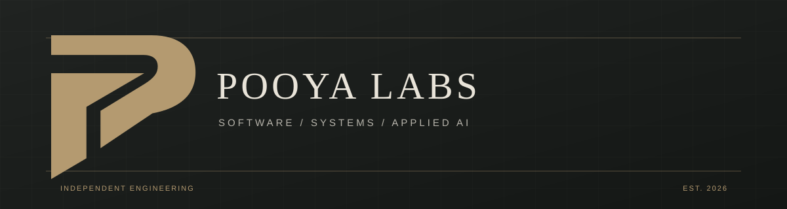

<!--
  Pooya Labs — GitHub profile README
  Bilingual profile: English first, Persian second.
-->

**Pooya Goodarzi**  
Software Engineering · AI Engineering · Product Development

[GitHub](https://github.com/pooya-labs) · [Telegram](https://t.me/pooyayee) · [Instagram](https://www.instagram.com/_p.ooya/)

[English](#english) · [فارسی](#فارسی)

---

## About

I’m Pooya Goodarzi, a Computer Engineering student focused on **software engineering, AI engineering, and digital product development**.

I design and build software across web products, backend services, distributed systems, observability, and applied AI. My work is guided by sound architecture, deliberate technical decisions, maintainability, and implementation that can be tested and inspected. I document project status and constraints explicitly; prototypes are presented as prototypes, not production systems.

- **Core focus:** Software Engineering · AI Engineering · Product Development
- **Technical interests:** Distributed Systems · Backend Architecture · Applied AI · Developer Tools
- **Engineering priorities:** Architecture, reliability, testing, security boundaries, and long-term maintainability
- **Current direction:** Building independent software products and strengthening the engineering behind them.

## Featured projects

A selection of projects I design and develop. Each repository documents its current capabilities, limitations, and next steps.

| Project | What it explores | Repository |
|---|---|---|
| **AetherFlow** | A Rust-based distributed workflow execution platform focused on durable state, recoverable workers, and explicit execution semantics. Experimental; not production-ready. | [Explore ↗](https://github.com/pooya-labs/aetherflow) |
| **ORBIT** | An observability platform for distributed services, with metrics, logs, traces, incident workflows, and a Go API. | [Explore ↗](https://github.com/pooya-labs/orbit) |
| **GlobalCart** | A bilingual marketplace simulation exploring catalog workflows, product discovery, pricing, and commerce UX. Not a live retailer. | [Explore ↗](https://github.com/pooya-labs/globalcart) |
| **Pooya.OS** | An interactive browser-based portfolio presented as a desktop workspace, with project case studies and engineering tools. | [Explore ↗](https://github.com/pooya-labs/pooya-os) |
| **AuraPulse** | A market-data dashboard and local paper-trading simulator, separating public quotes from illustrative demo data. | [Explore ↗](https://github.com/pooya-labs/aurapulse) |
| **NexusCanvas** | A visual system-architecture workspace for modeling service topologies, inspecting structural risks, and exporting starter artifacts. | [Explore ↗](https://github.com/pooya-labs/nexus-canvas) |
| **LuminaGlass** | A browser-native lab for optical interface effects, SVG/Canvas rendering, and audio processing. | [Explore ↗](https://github.com/pooya-labs/lumina-glass) |
| **Salon Booking** | A live v1.0.0 appointment-booking system with Persian RTL, Jalali dates, an owner workspace, Apps Script + Sheets backend, and Firebase manager notifications. | [Explore ↗](https://github.com/pooya-labs/salon-booking) |
| **Pooya Labs Platform** | The primary bilingual portfolio, with eight case studies, project evidence, architecture diagrams, and a novels library. Currently a pre-release portfolio draft. | [Explore ↗](https://github.com/pooya-labs/pooya-labs-platform) |

## Latest portfolio update — 8 November 2026

The project directory now reflects the current nine-project ecosystem and its latest release states: ORBIT v1.0.0 is stable within its documented demo scope, GlobalCart v1.0.0 is a marketplace demo, Salon Booking v1.0.0 is live and maintained, and AetherFlow remains experimental. Pooya Labs Platform is identified as the primary bilingual portfolio; it remains in pre-release review rather than being presented as a finished production product.

## Portfolio ownership

**Portfolio ecosystem and project ownership: [Pooya Labs Platform](https://pooya-labs.github.io/pooya-labs-platform/).** Created and maintained by **Pooya Goodarzi**.

## Engineering interests

- **AI Engineering:** applied AI, model integration, evaluation, and building useful AI-powered workflows.
- **Software Engineering:** maintainable code, testing, API design, and pragmatic architecture.
- **Systems:** distributed execution, observability, reliability, and data boundaries.
- **Product Engineering:** responsive interfaces, accessibility, localization, and end-to-end user journeys.

> The work should speak for itself: clear implementation, documented trade-offs, and verifiable results.

## Connect

- Telegram: [@pooyayee](https://t.me/pooyayee)
- Instagram: [@_p.ooya](https://www.instagram.com/_p.ooya/)
- GitHub: [@pooya-labs](https://github.com/pooya-labs)

---

## درباره من

من پویا گودرزی، دانشجوی مهندسی کامپیوتر هستم و تمرکزم بر **مهندسی نرم‌افزار، مهندسی هوش مصنوعی و توسعه محصولات دیجیتال** است.

در پروژه‌هایم روی طراحی و پیاده‌سازی نرم‌افزارهای تحت وب، سرویس‌های بک‌اند، سامانه‌های توزیع‌شده، ابزارهای مشاهده‌پذیری و کاربردهای عملی هوش مصنوعی کار می‌کنم. اصول فنی موردتوجه من معماری اصولی، تصمیم‌گیری مهندسی، قابلیت نگهداری، آزمون‌پذیری و شفافیت در بیان وضعیت واقعی هر پروژه است. نمونه‌های اولیه را به‌عنوان محصول آماده استفاده معرفی نمی‌کنم و محدودیت‌ها و مراحل باقی‌مانده را مستند نگه می‌دارم.

- **حوزه‌های اصلی:** مهندسی نرم‌افزار · مهندسی هوش مصنوعی · توسعه محصول
- **زمینه‌های فنی:** سامانه‌های توزیع‌شده · معماری بک‌اند · هوش مصنوعی کاربردی · ابزارهای توسعه
- **اولویت‌های مهندسی:** معماری، قابلیت اطمینان، آزمون، امنیت و نگهداری بلندمدت
- **مسیر فعلی:** طراحی و توسعه محصولات نرم‌افزاری مستقل و ارتقای کیفیت فنی آن‌ها.

## پروژه‌های منتخب

این‌ها بخشی از پروژه‌هایی هستند که طراحی و توسعه می‌دهم. در هر مخزن می‌توان جزئیات قابلیت‌های فعلی، محدودیت‌ها و مسیر توسعه را دید.

| پروژه | موضوع |
|---|---|
| **AetherFlow** | پلتفرمی مبتنی بر Rust برای اجرای گردش‌کارهای توزیع‌شده، با تمرکز بر وضعیت پایدار، بازیابی Workerها و معنای دقیق اجرای وظایف. پروژه آزمایشی است و هنوز آماده استفاده در محیط عملیاتی نیست. [مشاهده مخزن ↗](https://github.com/pooya-labs/aetherflow) |
| **ORBIT** | پلتفرم مشاهده‌پذیری سامانه‌های توزیع‌شده با پشتیبانی از معیارها، لاگ‌ها، ردگیری درخواست‌ها، مدیریت رخداد و API مبتنی بر Go. [مشاهده مخزن ↗](https://github.com/pooya-labs/orbit) |
| **GlobalCart** | شبیه‌سازی یک بازارگاه دوزبانه برای تجربه فرایندهای کاتالوگ، جست‌وجوی محصول، قیمت‌گذاری و طراحی تجربه خرید؛ فروشگاه واقعی نیست. [مشاهده مخزن ↗](https://github.com/pooya-labs/globalcart) |
| **Pooya.OS** | پورتفولیوی تعاملی تحت وب با ظاهر دسکتاپ، معرفی مطالعات موردی پروژه‌ها و ابزارهای مهندسی. [مشاهده مخزن ↗](https://github.com/pooya-labs/pooya-os) |
| **AuraPulse** | داشبورد داده‌های بازار و شبیه‌ساز معاملات آزمایشی در مرورگر، با تفکیک داده‌های عمومی از داده‌های نمایشی. [مشاهده مخزن ↗](https://github.com/pooya-labs/aurapulse) |
| **NexusCanvas** | محیط بصری طراحی معماری سیستم برای مدل‌سازی ارتباط سرویس‌ها، بررسی ریسک‌های ساختاری و خروجی‌گرفتن از طرح معماری. [مشاهده مخزن ↗](https://github.com/pooya-labs/nexus-canvas) |
| **LuminaGlass** | آزمایشگاه تحت وب برای جلوه‌های بصری، رندر SVG و Canvas و پردازش صوت در مرورگر. [مشاهده مخزن ↗](https://github.com/pooya-labs/lumina-glass) |
| **Salon Booking** | سامانهٔ رزرو نوبت نسخهٔ ۱.۰.۰ که منتشر شده و فعال است؛ با پنل مدیریت، backend مبتنی بر Apps Script و Sheets و اعلان مدیر از Firebase. [مشاهده مخزن ↗](https://github.com/pooya-labs/salon-booking) |
| **Pooya Labs Platform** | پورتفولیوی اصلی دوزبانه با هشت مطالعهٔ موردی، شواهد پروژه‌ها، نمودارهای معماری و کتابخانهٔ رمان‌ها؛ همچنان در مرحلهٔ پیش‌انتشار و بازبینی نهایی است. [مشاهده مخزن ↗](https://github.com/pooya-labs/pooya-labs-platform) |

## زمینه‌های مورد علاقه

- **مهندسی هوش مصنوعی:** کاربرد عملی مدل‌ها، ارزیابی، یکپارچه‌سازی و ساخت گردش‌کارهای هوشمند مفید.
- **مهندسی نرم‌افزار:** کدنویسی قابل نگهداری، آزمون، طراحی API و معماری واقع‌گرایانه.
- **مهندسی سیستم‌ها:** اجرای توزیع‌شده، مشاهده‌پذیری، قابلیت اطمینان و مرزبندی داده‌ها.
- **مهندسی محصول:** رابط واکنش‌گرا، دسترس‌پذیری، بومی‌سازی و طراحی جریان کامل کاربر.

> معیار کار مهندسی، پیاده‌سازی قابل‌بررسی، تصمیم‌های فنی مستند و نتیجه‌ای است که بتوان آن را آزمود و ارزیابی کرد.

## راه‌های ارتباطی

- تلگرام: [@pooyayee](https://t.me/pooyayee)
- اینستاگرام: [@_p.ooya](https://www.instagram.com/_p.ooya/)
- گیت‌هاب: [@pooya-labs](https://github.com/pooya-labs)

---

**Pooya Labs** · Independent projects, practical engineering, continuous learning.

ساختن، آزمایش‌کردن و بهترکردن؛ قدم‌به‌قدم.

## آخرین به‌روزرسانی پورتفولیو — ۸ نوامبر ۲۰۲۶

فهرست پروژه‌ها با وضعیت فعلی مجموعهٔ ۹ پروژه‌ای هماهنگ شد: ORBIT نسخهٔ پایدار ۱.۰.۰ را در محدودهٔ دموی مستندشده دارد، GlobalCart نسخهٔ نمایشی ۱.۰.۰ است، Salon Booking نسخهٔ ۱.۰.۰ منتشرشده و فعال دارد و AetherFlow همچنان آزمایشی است. پلتفرم پویا لبز به‌عنوان پورتفولیوی اصلی دوزبانه معرفی شده، اما هنوز در مرحلهٔ پیش‌انتشار و بازبینی قرار دارد.

## مالکیت پورتفولیو

**مالک و نگه‌دارندهٔ اکوسیستم پروژه‌ها: [پلتفرم پویا لبز](https://pooya-labs.github.io/pooya-labs-platform/)** · بنیان‌گذار و توسعه‌دهنده: **پویا گودرزی**.
